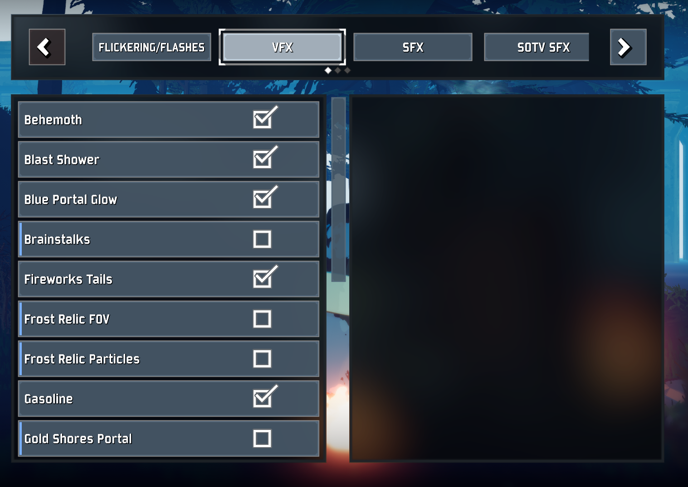

# HC AV Effect Options

This is an update of [SOTS AVEffect Options](https://thunderstore.io/c/riskofrain2/p/Nuxlar/SOTS_AV_Effect_Options/) which is an update of [JPs AV Effect Options](https://thunderstore.io/c/riskofrain2/p/TeamNinjaDSM/JPs_AV_Effect_Options/)

Below README based on original.

## About

The goal is to allow players to selectively disable in-game audio-visual effects that aren't strictly necessary to enjoy the game without changing game mechanics or balance. This may assist people who, among others; have photosensitivity, are sensitive to sensory overstimulation, or have limited computing resources. Effects can [usually] be toggled mid-stage.

Intended for headed client-side installations. [Should] have no effect on headless installations.

### Currently configurable

- Blast Shower's effects
- Blue/Gold portals' light
- Brainstalks' screen effect
- Brilliant Behemoth's explosion
- Elusive Antlers' orb spawn sound
- Faraday Spur's jump explosion and passive electric sound when charged
- Firework's trails
- Frost Relic particles and FOV change
- Gasoline's explosion
- Interstellar Desk Plant's indicator ward particle effects
- Kjaro's Band tornado
- Little Disciple's sounds
- Molten Perferator's fireballs
- Runald's Band explosion
- Plasma Shrimp AV effects
- Shatterspleen's explosion
- Shuriken's spawn sound
- Stained Scimitar's spawn and idle loop sounds
- Spinel Tonic's screen effect
- Sticky Bomb's drops & explosion
- Stone Titan's death effect
- Void Fiend's movement sounds
- Wandering Vagrant's death explosion
- Weeping Fungus' effects
- Will-o'-the-Wisp explosion
- Speed and Intensity of (most) flickering lights in the game
- Intensity of allies and enemies heal flash effect
- Intensity of allies and enemies damage flash effect

## Configuring

Once this mod is installed, just press ESC in your game client and go to SETTINGS. Risk Of Options will have a tab there where all items have toggles.

Use [Rune580's Risk of Options](https://thunderstore.io/package/Rune580/Risk_Of_Options)

## Credits

- [.score](https://github.com/goldenguy00) for helping me understand why the plasma shrimp audio setting wasn't working after hc
- [Rune580](https://github.com/Rune580) for [Risk of Options](https://thunderstore.io/package/Rune580/Risk_Of_Options)
- [tlsJP](https://github.com/tlsJP) for the [original version the mod](https://thunderstore.io/c/riskofrain2/p/TeamNinjaDSM/JPs_AV_Effect_Options/)
- [Nuxlar](https://github.com/Nuxlar) for the [SOTS version the mod](https://thunderstore.io/c/riskofrain2/p/Nuxlar/SOTS_AV_Effect_Options/)
